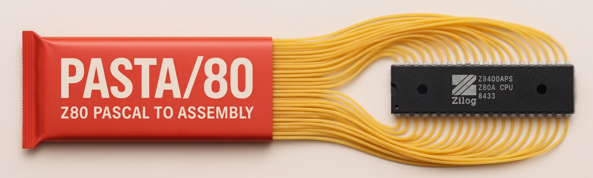

<a href="../README.md">Compiler Manual</a> | <a href="../docs/rtl-reference.md">Library Reference</a>

# PASTA/80 Example Code

The `examples` folder contains programs that show what PASTA/80 can do, from the canonical "Hello, world" to games, fractals and sound. The table lists which platforms each example runs on. Compiling an example for a platform it does not support stops with an error message that names the supported ones.

| Example | Description | CP/M | 48K | 128K | Next | Agon |
|---|---|:-:|:-:|:-:|:-:|:-:|
| [2048](2048.pas) | The sliding tile puzzle game 2048. | ✓ | ✓ | ✓ | ✓ | ✓ |
| [anagrams](anagrams.pas) | Prints all anagrams of a word, using recursion. | ✓ | ✓ | ✓ | ✓ | ✓ |
| [animals](animals.pas) | Animal guessing game that learns new animals, similar to "Pangolins" from the ZX Spectrum manual. | ✓ | | | ✓ | ✓ |
| [barnsley](barnsley.pas) | Draws the Barnsley fern fractal. | | ✓ | ✓ | ✓ | ✓ |
| [barnsley256](barnsley256.pas) | Barnsley fern in different shades of green. | | | | ✓ | |
| [barnsleyagon](barnsleyagon.pas) | Multi-coloured Barnsley fern for the Agon. | | | | | ✓ |
| [beepfx](beepfx.pas) | Plays sound effects with Shiru's BeepFX player, linked in as assembly. | | ✓ | ✓ | ✓ | |
| [breakpoints](breakpoints.pas) | Shows breakpoints set with `Debug`. Start it in the debugger to see how it works. | ✓ | ✓ | ✓ | ✓ | ✓ |
| [bubble](bubble.pas) | Sorts random numbers with bubble sort. | ✓ | ✓ | ✓ | ✓ | ✓ |
| [calc](calc.pas) | Calculator for real-valued expressions with parentheses, E-notation and functions like `Sin` and `Cos`. | ✓ | ✓ | ✓ | ✓ | ✓ |
| [colors](colors.pas) | Shows all combinations of text and background colours. | ✓ | ✓ | ✓ | ✓ | ✓ |
| [crt](crt.pas) | Prints coloured text at random places on the screen. | ✓ | ✓ | ✓ | ✓ | ✓ |
| [dicer](dicer.pas) | Rolls six-sided dice for you (recognizing 6 times 3D6 as D&D stats). | ✓ | ✓ | ✓ | ✓ | ✓ |
| [divmod](divmod.pas) | Adds an assembly function and makes it available to Pascal with the `register` calling convention. | ✓ | ✓ | ✓ | ✓ | ✓ |
| [fact](fact.pas) | Calculates factorials, the iterative way. | ✓ | ✓ | ✓ | ✓ | ✓ |
| [fibo](fibo.pas) | Calculates the first 25 Fibonacci numbers. | ✓ | ✓ | ✓ | ✓ | ✓ |
| [gfx](gfx.pas) | Shows some of the available graphics primitives. | | ✓ | ✓ | ✓ | ✓ |
| [hat](hat.pas) | Draws the classic 3D "hat" from the 1980s computer magazines. | | ✓ | ✓ | ✓ | ✓ |
| [hat256](hat256.pas) | The 3D hat in 256 colours. | | | | ✓ | |
| [hatagon](hatagon.pas) | The 3D hat in colour for the Agon. | | | | | ✓ |
| [hello](hello.pas) | A simple "Hello, world". | ✓ | ✓ | ✓ | ✓ | ✓ |
| [hexdump](hexdump.pas) | Prints a hex dump of a file named on the command line. | ✓ | | | | ✓ |
| [hilbert](hilbert.pas) | Draws a Hilbert curve with recursive turtle graphics. | | ✓ | ✓ | ✓ | ✓ |
| [jacques](jacques.pas) | Plays "Frère Jacques". | | ✓ | ✓ | ✓ | ✓ |
| [knight](knight.pas) | Finds all tours of a knight on a 5x5 board. | ✓ | ✓ | ✓ | ✓ | ✓ |
| [knight8](knight8.pas) | Draws a knight's tour of the 8x8 board by Warnsdorff's rule, with sound, and maps where the rule succeeds.¹ | | ✓ | ✓ | ✓ | |
| [life](life.pas) | Conway's Game of Life. | ✓ | ✓ | ✓ | ✓ | ✓ |
| [mandelbrot](mandelbrot.pas) | Draws the Mandelbrot set in black and white. | | ✓ | ✓ | ✓ | ✓ |
| [mandelbrot256](mandelbrot256.pas) | Draws the Mandelbrot set in 256 colours on Layer 2. | | | | ✓ | |
| [maze](maze.pas) | Draws a random maze by recursive backtracking. | | ✓ | ✓ | ✓ | ✓ |
| [mc](mc/mc.pas) | MicroCalc, the small spreadsheet that came with Turbo Pascal 3.² | ✓ | | | | ✓ |
| [pq](pq.pas) | Solves quadratic equations with the pq formula. | ✓ | ✓ | ✓ | ✓ | ✓ |
| [primes](primes.pas) | Calculates the first 1000 prime numbers. | ✓ | ✓ | ✓ | ✓ | ✓ |
| [quick](quick.pas) | Sorts random numbers with Quicksort. | ✓ | ✓ | ✓ | ✓ | ✓ |
| [rot13](rot13.pas) | Encrypts text with ROT13. | ✓ | ✓ | ✓ | ✓ | ✓ |
| [screen](screen.pas) | Explores the Agon's screen modes, with `info` and interactive `try` commands. | | | | | ✓ |
| [sierpinski](sierpinski.pas) | Draws the Sierpinski triangle. | | ✓ | ✓ | ✓ | ✓ |
| [squares](squares.pas) | Calculates some square numbers. | ✓ | ✓ | ✓ | ✓ | ✓ |
| [timer](timer.pas) | A simple timer using `Delay`. | ✓ | ✓ | ✓ | ✓ | ✓ |
| [towers](towers.pas) | Solves the Towers of Hanoi with seven discs, with sound and binary move counter lights.¹ | | ✓ | ✓ | ✓ | |
| [ulam](ulam.pas) | Draws the Ulam spiral of primes, clicking for each pair of twin primes.¹ | | ✓ | ✓ | ✓ | |
| [zxattrs](zxattrs.pas) | Shows the ZX Spectrum's screen attributes. | | ✓ | ✓ | ✓ | |
| [zxsum](zxsum.pas) | Exchanges data between ZX BASIC and Pascal. | | ✓ | ✓ | | |

The examples are public domain, with two exceptions:

1. Written by Fern and published under the MIT License, Copyright (c) 2026 Melissa O'Neill.
2. Copyright Borland International, donated to the public domain for non-commercial use only.
